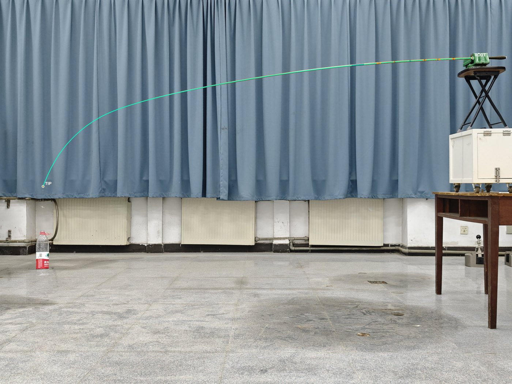

# rod-curve-vision

Extract a fishing rod's bent centerline from a single side-view photograph, convert it to millimetres, then invert for bending stiffness with a variable-stiffness, large-deflection beam model. Everything runs locally; no photo or result leaves the machine.

[中文](README.md) | English



## Why

A fishing rod is a clean mechanics problem — a tapered, variable-stiffness cantilever under a tip load plus self weight — but a poorly documented engineering object. Manufacturers publish a "power/tone" label (28-tone, 37-tone), a length and a mass. They do not publish bending stiffness, per-section modulus, or joint compliance.

The usual experiment measures a single number: how far the tip drops under a known weight. One number cannot separate "the whole rod is soft" from "only the tip section is soft", and those two cases behave very differently when casting or breaking.

So this project measures the **whole curve** instead of one endpoint:

1. **Dense measurement.** A photograph of the loaded rod is traced by image analysis into roughly a thousand sub-pixel centerline samples.
2. **A model that can use them.** A large-deflection variable-stiffness beam model fits that curve and returns several stiffness parameters, together with a criterion for whether the curve actually supports that many parameters.

## Two halves

**Image analysis** (`rodcurve/`) — two image-evidence channels (yellow paint interior, thin dark line), a dynamic-programming path search inside a narrow strip between two user anchors, a cross-section midpoint refinement that removes the half-diameter bias, then a spline fit constrained to the anchors and resampled at constant arc length.

**Mechanics** (`rodcurve/webui/model.html`) — variable-stiffness Euler–Bernoulli beam with large rotations retained; overlapping tube sections add their stiffness; joint rotational stiffness enters as a series compliance; total-potential-energy stationarity solved by Newton iteration with load continuation. Supports calibration of `B₀` from a tip-drop test, and simultaneous inversion of `B₀` and fourth-section stiffness `B₄` from a whole measured curve.

Details: [docs/algorithm.md](docs/algorithm.md) and [docs/theory.md](docs/theory.md) (both in Chinese, with the formulas as implemented).

## What is verified

| Item | Result |
|---|---|
| Absolute accuracy on a synthetic frame with a known centerline | RMSE 0.81 px, 95th percentile 1.44 px |
| Regression against the original experimental records (6 cases) | median 0.18 px, P95 0.78 px |
| Runtime per 12 MP frame | 2.5–3.5 s total, of which 0.19 s is computation |
| Test suite | 19 tests, `python -m pytest tests -q` |

The synthetic case is the only one with a ground truth; the regression comparison shows the refactor did not change numerical behaviour. See [docs/validation.md](docs/validation.md) for the full table, the timing breakdown, and the limitations (single-plane assumption, sub-pixel rod width, occlusion).

## Install and run

```bash
git clone https://github.com/99999vvain/rod-curve-vision.git
cd rod-curve-vision
python -m pip install -r requirements-dev.txt

python -m rodcurve.server examples/sample-rod-57g.jpg   # browser UI
python -m rodcurve examples/sample-rod-57g.jpg \
    --point 3781,463 --point 1908,647 --point 344,1491 --length-mm 3350
python -m rodcurve --cases examples/cases.csv --jobs 4 --no-plot   # batch
```

Outputs land in `outputs/<photo>/`: `centerline.csv`, `overlay.png`, `curve.png`, `measurement.json`.

See [docs/usage.md](docs/usage.md) for the parameter table, the CSV schema, the planar calibration file format and troubleshooting.

## Authors

Joint work by **Lin Weixu (林卫叙)** and **Wang Feiyang (王飞扬)**.

## License

MIT — see [LICENSE](LICENSE).
