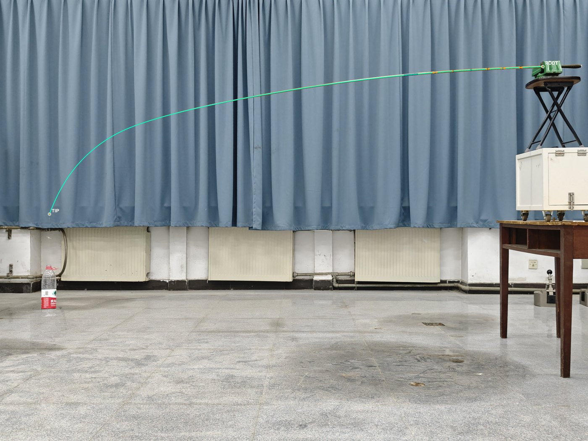
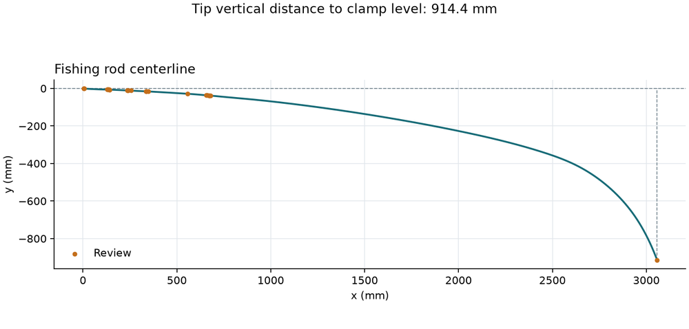

# rod-curve-vision · 鱼竿变形曲线识别与力学预测

从一张侧视照片出发，提取鱼竿在端载下的变形中心线，换算成毫米坐标，再用变刚度大变形梁模型反算弯曲刚度、预测其他工况下的变形。识别与力学两段全部在本机跑，不上传任何数据。

<p align="left">
  
  
  
</p>

[English](README.en.md) | 中文



*青色为提取的中心线，橙色为建议人工复核的点，ROOT / TIP 为人工参照点。样图：自由段 3 350 mm，梢端挂 56.9 g。*



*同一工况输出的毫米坐标曲线：梢端相对夹具出口所在水平面下落 914.4 mm。*

---

## 项目背景

鱼竿是一个力学上很干净、工程上却很含糊的对象。

说它干净：一根变截面、变刚度的悬臂梁，端部受集中力，自重沿弧长分布，教材里的梁理论几乎可以逐条对上。说它含糊：市售鱼竿只标"调性"（28 调、37 调）、长度和自重，不标弯曲刚度、不标各节模量、不标接头柔度。想算一支竿在某个挂重下的挠度曲线，手上没有可用的参数。

而钓重、抛投手感、断竿位置这些实际问题，全部取决于那几组没人公布的数。

传统做法是挂重后拿尺子量梢端落差，得到**一个**数字。一个问题：一个数字无法区分"整支竿偏软"和"只有梢节偏软"——而这两种情况的钓性和断竿风险完全不同。

所以本项目从两个方向入手：

1. **把测量做密**。挂重后拍一张侧视照片，用图像识别把整条变形曲线取出来（上千个点，亚像素精度），而不是只量一个端点位移。
2. **把模型做对**。用允许大转角的变刚度梁模型去拟合这条曲线，一次反算出多个刚度参数，并给出"这条曲线够不够支撑这个结论"的判据。

两者合起来才是闭环：照片 → 毫米中心线 → 力学反演 → 刚度参数 → 预测任意工况。

本项目面向 2026 年江苏省第六届力学创新创意竞赛，研究对象为民用钓鱼竿的力学性能：先解析现有市售鱼竿，再基于解析结果做材料、截面与结构层面的优化设计。本仓库是"解析"这一侧的工具链。

## 两个板块

```
侧视照片 ──图像识别──▶ 中心线 CSV（s, x, y, 证据, 复核标记）
                              │
                              ▼
                     力学模型（浏览器内求解）
                              │
              ┌───────────────┼───────────────┐
              ▼               ▼               ▼
        变形曲线预测      刚度反算 B₀/B₄    实验-预测误差
```

**板块一 · 图像识别**（`rodcurve/`）
涂装段按黄色内部、细梢段按暗线，构造两路图像证据；在参照点之间的窄带内用动态规划找连续路径；再用局部截面中点把半杆宽的系统偏差修正掉；最后用带参照点强约束的样条拟合并按等弧长重采样。

**板块二 · 力学预测**（`rodcurve/webui/model.html`）
变刚度 Euler–Bernoulli 梁，保留大转角几何非线性；搭接区两根管的刚度叠加，接头转动刚度以串联柔度计入；总势能驻值 + Newton 迭代 + 载荷续算求解；支持梢端落差标定 `B₀`、以及由整条实测曲线同时反算 `B₀` 与第四节刚度 `B₄`。

细节见 [docs/algorithm.md](docs/algorithm.md) 与 [docs/theory.md](docs/theory.md)。

## 特色

**1. 端到端，且闭环可验证**
识别出的 CSV 直接进力学模型，模型算出的曲线又反过来和实测曲线按弧长配对比较。不是两个各自能跑的程序拼在一起，而是一条能被数据检验的链路。

**2. 精度有绝对标定，不只是"看起来贴合"**
真实照片没有真值，所以项目里有一张中心线已知的合成图作为精度基准：**RMSE 0.81 px、95 分位 1.44 px**（4096 px 画幅，折合 3 500 px 弧长上约 0.02%）。测试随仓库分发，一条命令可复现：

```bash
python -m pytest tests -q      # 19 项，全部通过
```

与原始实验记录的逐点回归比对（`tools/validate_against_reference.py`）中位偏差 **0.18 px**，说明重构没有改变数值行为。详见 [docs/validation.md](docs/validation.md)。

**3. 不靠小转角近似**
弯到几十度的鱼竿，用 `y″ = M/EI` 的线性解会系统性低估挠度。这里直接用大转角方程 + 能量法求解，小转角解只作为对照曲线出现——两条件曲线放在一张图里，差多少一眼能看到。

**4. 刚度不是一个数，而是可分辨的多个数**
- 梢端落差标定给出基准刚度 `B₀`；
- 四节竿可由整条曲线同时反算 `B₀` 与第四节 `B₄`，用一个阻尼 Gauss–Newton，多起点避免局部极小；
- 反算完成后给出**可辨识性判据**：两个方向的灵敏度不足时明确提示"这条曲线不足以分辨 B₀ 和 B₄"，而不是给一个看似精确实则不可信的数值。

**5. 误差按弧长配对，不是点对点相减**
两条折线的采样密度不同，逐点相减会引入采样误差。程序在共同弧长区间上分别线性插值，逐段**解析积分**平方误差，得到的 RMSE 与采样密度无关，不同工况之间可以直接横向比较。

**6. 会告诉你哪里不可信**
每个采样点带一个图像证据值；证据过弱、或样条与追踪点偏离过大的位置会被标成橙点（CSV 里 `needs_review=1`）。6 组实验工况的复核比例为 0.7%–6.7%，最高的一组同时也是偏差最大的一组。

**7. 三种入口，一套代码**
浏览器界面（`python -m rodcurve.server`）、命令行、批量清单、Tkinter 窗口，全部调用 `rodcurve/` 同一个实现，不存在"界面版和脚本版结果不一样"。

## 快速开始

```bash
git clone https://github.com/99999vvain/rod-curve-vision.git
cd rod-curve-vision
python -m pip install -r requirements.txt

# 浏览器界面，启动时载入示例照片
python -m rodcurve.server examples/sample-rod-57g.jpg
```

命令行提取：

```bash
python -m rodcurve examples/sample-rod-57g.jpg \
  --point 3781,463 --point 1908,647 --point 344,1491 \
  --length-mm 3350
```

输出在 `outputs/sample-rod-57g/`：`centerline.csv`、`overlay.png`、`curve.png`、`measurement.json`。

批量（一份清单跑完整个实验）：

```bash
python -m rodcurve --cases cases.csv --jobs 4 --no-plot
```

完整用法、参数表、CSV 列定义与常见问题见 [docs/usage.md](docs/usage.md)。

## 示例数据

`examples/` 里有两组实拍照片（4096 × 3072，原分辨率）与对应的历史记录 CSV：

| 文件 | 工况 |
|---|---|
| `sample-rod-0g.jpg` | 自由段 3 350 mm，仅自重 |
| `sample-rod-57g.jpg` | 自由段 3 350 mm，梢端挂 56.9 g |

`*-reference.csv` 是实验时留下的记录，只用于回归比对，不作为真值。

## 目录

```
rodcurve/            识别与标定
  evidence.py        黄色内部 + 暗线两路证据
  tracing.py         条带重采样、动态规划路径、截面中点修正、样条重采样
  calibration.py     弧长/mm 比例、平面单应标定、夹持角
  export.py          CSV / 叠加图 / 曲线图
  cli.py             命令行与批量
  server.py          本地 Web 服务（浏览器界面的后端）
rodcurve/webui/      前端（识别页 + 力学模型页）
tools/               回归比对脚本、Tkinter 桌面版
tests/               合成图精度测试、CLI 端到端测试
docs/                算法、力学模型、使用说明、验证记录
examples/            示例照片与历史记录
```

## 精度与局限

| 项目 | 结果 |
|---|---|
| 合成图绝对精度 | RMSE 0.81 px |
| 与历史记录回归 | 中位 0.18 px，P95 0.78 px |
| 单张耗时（12 MP） | 约 2.5–3.5 s，其中计算 0.19 s |
| 批量 6 张 | 串行 9.7 s / 4 进程 6.1 s |

局限同样明确：

- 实拍照片**没有真值**，能保证的是与实验记录一致，不是"比实测更准"；
- 全流程假设杆在垂直于光轴的平面内弯曲，相机俯仰明显时必须用平面标定，否则弧长系统性偏短；
- 杆宽低于约 1.5 px 时截面中点退化为整像素，精度由像素量化决定（3 350 mm 自由段上约 ±4 mm）；
- 杆被遮挡或与背景同色时路径可能沿错误结构行进，程序会标橙点但不会自动修正。

详见 [docs/validation.md](docs/validation.md)。

## 作者

本项目由 **林卫叙**、**王飞扬** 共同完成（中国矿业大学力学与土木工程学院）。

分工按共同参与记录，不拆分单项。如有引用或合作需求，请通过仓库 Issues 联系。

## 引用

```bibtex
@software{rod_curve_vision,
  title  = {rod-curve-vision: 鱼竿变形曲线识别与力学预测},
  author = {林卫叙 and 王飞扬},
  year   = {2026},
  url    = {https://github.com/99999vvain/rod-curve-vision}
}
```

## 许可证

MIT，见 [LICENSE](LICENSE)。第三方依赖的许可证在各自包内，主要涉及 OpenCV（Apache-2.0）、NumPy/SciPy（BSD-3-Clause）、Pillow（MIT-CMU）、Matplotlib（PSF-based）。
